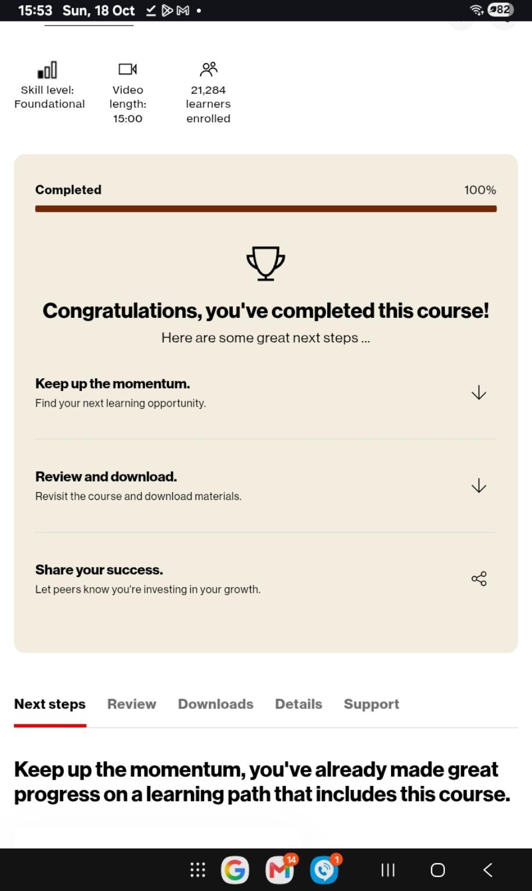

# Learning milestone: AI marketing course
Mya P. Brown, founder of Civic Continuum, reports completing **Activate cutting-edge marketing strategies with the power of AI** through **Verizon Small Business Digital Ready** on October 18, 2026.

## Evidence

The owner supplied this completion screenshot and the course worksheet bearing the title above. The screenshot itself does not display the course title or learner name, so it is supporting evidence rather than a named credential. No separate certificate has been received or verified. This milestone is course completion, not professional certification or Verizon endorsement of Civic Continuum.

## Application to Civic Continuum
The worksheet covers market research, audience segmentation, competitor analysis, website audits, conversion paths and a measurable marketing plan. We intend to apply the learning to clearer product explanations, mobile website usability, customer feedback and evidence-based marketing. No business results from these changes are claimed yet.

Learning provider: Verizon Small Business Digital Ready. Learning undertaken for Civic Continuum's business development; no paid client commission or partnership implied.

Next planned course: **Protecting intellectual property: Safeguard what you create**. This record does not claim two-course grant eligibility, an application submission or an award.

The provider's worksheet remains with the owner; it is not republished here.
