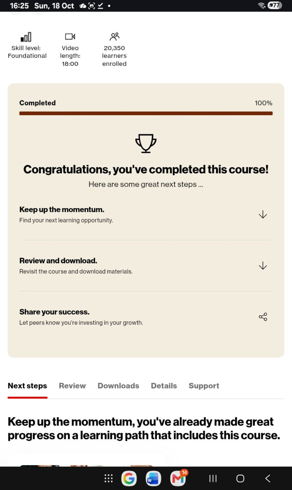

# Two business-learning milestones — October 18, 2026
Mya P. Brown reports completing these Verizon Small Business Digital Ready courses for Civic Continuum business development:
1. Activate cutting-edge marketing strategies with the power of AI.
2. Protecting intellectual property: Safeguard what you create.

[First completion record and worksheet context](VERIZON_AI_MARKETING_COMPLETION_2026-10-18.md).

Evidence: owner completion reports, screenshots showing Completed 100%, the titled marketing worksheet, and owner-forwarded course activity text. Screenshots do not show course titles or learner names; no separate certificate is verified. This is course completion, not professional certification, endorsement, or proof of company-wide security.

Owner-supplied course link: https://dashboard-digitalready.verizonwireless.com/course-details/course:8979456
This identifies a course page and may require sign-in; it is not a public transcript or a link that verifies this learner's completion. It is associated with the marketing course in the earlier catalog evidence; do not label it the IP course or a certificate.

[How we are applying the learning](IP_SECURITY_AND_MARKETING_PRACTICES.md).
Verizon support and LISC were emailed October18 to confirm credits and next application steps. Two qualifying completions can unlock the competitive grant application; no application submission, award or funds received is claimed.
